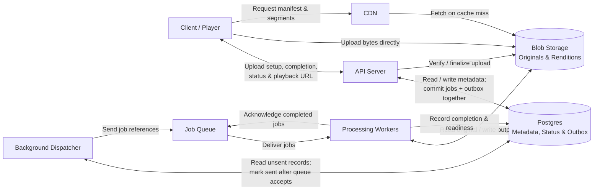

# Video Processing Pipeline — Project Overview

This system lets users upload prerecorded videos, processes them asynchronously into multiple resolutions, and delivers playback through a CDN. The central flow is **upload → process → watch**.

This overview consolidates **APIs**, **High Level chart**, and **Core entities**, incorporating later refinements from **Design video processing pipeline**. It describes the current system design exercise, not an implemented service. Detailed schemas and some reliability mechanisms remain open.

## Scope and requirements

Users can upload videos, resume interrupted uploads, check processing status, and watch available resolutions. Live streaming, recommendations, comments, and subscriptions are outside the exercise’s scope.

| Area | Exercise assumption or target |
|---|---|
| Input limits | Up to 5 GB and 30 minutes per video |
| Traffic | 10,000 uploads/day and 1 million playback starts/day, with spikes |
| Output resolutions | 360p, 720p, and 1080p, where the source supports them |
| Processing | Asynchronous; an upload need not be immediately playable |
| Playback availability | 99.9% successful playback starts for ready videos |
| Playback latency | p95 time to first frame under 2 seconds on a supported device with a good connection |
| Durability and recovery | Completed uploads survive server failures; interrupted uploads resume; transient processing failures recover automatically |

A processing outage should not prevent playback of already processed videos. Slightly stale progress information is acceptable, but a resolution must not be advertised before its playable output is complete and verified.

## Core entities

These are logical entities; the final database schema has not been defined. Metadata and file references live in Postgres, while video bytes live in object storage such as S3.

| Entity | Purpose | Information discussed |
|---|---|---|
| **User** | Identifies the uploader and owner; the same person may also be a viewer. | User identity and video ownership |
| **Video** | Represents one logical video throughout its lifecycle. | Title, owner, duration, original file location, overall status, and playback readiness |
| **UploadSession** | Tracks an upload attempt and supports resuming it. | Storage upload ID, target object, expected file and part sizes, and confirmed uploaded parts with receipts or checksums |
| **ProcessingJob** | Tracks background work, such as converting a video to 720p. | Job identity, target conversion/output, and state: `pending`, `running`, `completed`, or `failed` |
| **VideoRendition** | Represents a processed version at a particular resolution. | Resolution, playback file location(s), and readiness/processing status |

One **Video** has multiple **VideoRenditions**. A **ProcessingJob** represents the work that produces a rendition; retrying that work does not create a new logical video. Upload sessions and jobs reference the video they belong to. Job management remains internal and does not require public CRUD endpoints.

The later reliability discussion also introduces an internal **outbox record**: a durable instruction to send a processing job to the queue. It supports dispatch rather than adding a sixth core product entity.

## Public APIs

The contract below incorporates the later correction from `processing` to `queued` at upload completion, plus the separate `playbackReady` indicator introduced during the deep dive.

| Operation | Endpoint | Request | Response / behavior |
|---|---|---|---|
| Start an upload | `POST /videos` | `title`, `fileName`, `fileSizeBytes` | `201 Created`: `videoId`, `uploadId`, `uploadUrl` |
| Complete an upload | `POST /videos/{videoId}/uploads/{uploadId}/complete` | No body in the initial contract; multipart details remain to be specified | `202 Accepted` with `status: "queued"` after upload verification and durable acceptance of processing work |
| Check video status | `GET /videos/{videoId}/status` | No body | `status`, `playbackReady`, `availableResolutions`; detailed progress fields remain to be specified |
| Get playback information | `GET /videos/{videoId}/playback` | No body | `playbackUrl`, `availableResolutions` when playable; `409 Conflict` with current status was proposed when no rendition is playable |

- The server derives ownership from authentication; the client does not supply `userId` in the start request.
- `POST /videos` creates metadata and an upload session. The client then transfers bytes **directly to storage**, using temporary upload permission for a specific location.
- `/complete` verifies the upload and accepts background work without waiting for conversion. Repeated calls return the current state without creating duplicate processing jobs.
- `availableResolutions` contains only successfully processed, playable outputs.
- `playbackUrl` points to a CDN-served manifest describing the available versions and playback segments. The API returns playback information; the CDN delivers the video content.

Video-level states discussed include `uploading`, `queued`, `processing`, `ready`, and `failed`. Playback readiness is independent of overall processing progress. For example:

```json
{
  "status": "processing",
  "playbackReady": true,
  "availableResolutions": [360]
}
```

Here, playback can begin at 360p while higher resolutions continue processing. If a higher-resolution job ultimately fails, the successful renditions remain watchable. The full aggregate video-state transition rules remain to be defined.

## High-level architecture

The chart retains the compact structure from **High Level chart**, with the dispatcher/outbox refinement from the later reliability discussion.



**Three client paths:** API requests go through the server, upload bytes go directly to storage, and playback content comes through the CDN. Queue messages carry job references, not video bytes. The queue holds pending work until workers can process it.

### End-to-end flow

1. **Create:** The client calls `POST /videos`; the API creates the video and upload session and returns upload information.
2. **Upload:** The client transfers the original into blob storage. For resumable uploads, confirmed parts are tracked so only missing parts need to be sent again.
3. **Accept processing:** On `/complete`, the server checks all required parts, finalizes multipart storage upload if applicable, and verifies success. It then commits processing jobs and outbox records in one Postgres transaction and returns `202 Accepted`.
4. **Dispatch:** A background dispatcher sends unsent outbox job references to the queue, marking records sent only after the queue confirms acceptance.
5. **Process:** Workers read the original, generate renditions and playback files, verify output, record readiness/completion in Postgres, and acknowledge queue messages.
6. **Publish:** The client checks status and requests playback information. Playback becomes available as soon as the first rendition is complete and verified.
7. **Watch:** The player requests the manifest and segments through the CDN. Cache hits are served from the edge; cache misses fetch content from blob storage.

## Reliability and playback refinements

| Concern | Current design direction |
|---|---|
| Interrupted uploads | Track the set of confirmed parts, not just the last part number, because parallel uploads can finish out of order. Storage may hold the authoritative part list. |
| Incomplete `/complete` request | Report missing parts so the client can upload them. Do not begin processing until storage finalization succeeds. |
| API crash before queue dispatch | Commit jobs and outbox records together. The dispatcher can send outstanding work after the API restarts. |
| Worker crash | Retain work until acknowledgment. A visibility timeout makes unacknowledged jobs available again; long-running workers can extend that timeout. |
| Duplicate delivery | Check the specific job’s completion state. Completed jobs are acknowledged without repeating conversion. Concurrent workers processing the same unfinished job still need a coordination design. |
| Output saved before database update | Use a predictable, versioned output location. Verify existing output before recording completion; file existence alone is insufficient. |
| Persistent processing failures | Bound retries and use increasing delays with jitter. Three retries means up to four attempts. Corrupt or unsupported input should fail without repeated retries; exhausted work can go to a dead-letter queue. |
| Partial processing success | Keep ready renditions playable while other jobs run or fail. |

**Upload parts and playback segments solve different problems.** Upload parts make large file transfer resumable. Playback segments let the player download short intervals and switch quality as bandwidth changes. Smooth adaptive playback requires aligned segment boundaries and keyframes across renditions; manifests tell the player what is available.

## Open design work

> **Status:** concurrent claims (item 2), uniqueness rules and aggregate states (item 3), and retry limits with queue behavior (item 5) are resolved under *Implementation decisions* below. Multipart details, output verification and manifest publication are scheduled for M5–M7 in [docs/ROADMAP.md](docs/ROADMAP.md).

- Define multipart initiation, part authorization, resume, and completion request details beyond the four high-level APIs.
- Specify how concurrent workers claim the same unfinished job and prevent conflicting completion updates.
- Finalize database relationships, uniqueness rules, aggregate video states, and detailed progress/error responses.
- Define complete-output verification and safe manifest publication as new renditions become ready.
- Choose concrete queue behavior, retry limits, capacity/scaling policies, and operational monitoring.

## Source chats

- [APIs](codex://threads/01a10543-3043-7683-abd9-2f61afcfdf9b) — four client operations and initial request/response contract.
- [High Level chart](codex://threads/01a10552-0f7a-70c2-83d4-6607389832d6) — storage split, corrected API behavior, and compact Mermaid architecture.
- [Core entities](codex://threads/01a1052c-4651-7d51-ba7a-7df75eed71ae) — five logical entities and their roles.
- [Design video processing pipeline](codex://threads/01a10514-9a8a-7811-8ece-1e4ea9a7a47b) — later refinements for resumability, retries, partial readiness, adaptive playback, and transactional outbox dispatch.

## Implementation decisions

These choices close the open items above. The implementation follows them; see [docs/ROADMAP.md](docs/ROADMAP.md) for milestones and progress.

- **Postgres owns job state; the queue only wakes workers up.** Messages carry a `jobId`. Workers claim the row before doing work, and a reconciler re-enqueues jobs that are stuck or whose lease has expired.
- **Claiming and fencing:** a worker claims a job with a conditional `UPDATE` that increments `attempt` and sets `lease_expires_at`. The completion write includes `WHERE attempt = <mine>`, so a stale worker's write matches 0 rows. A heartbeat renews the DB lease and the queue visibility timeout every lease/3, and abandons the work if renewal finds the lease gone. Without it, any job longer than one lease livelocks: it is reclaimed mid-run, and every attempt's result is rejected by fencing. The first chaos run hit exactly this.
- **`/complete` creates one `probe` job**, not one job per resolution. The probe checks the real duration, resolution, and decodability, then creates the eligible transcode jobs and their outbox rows in one transaction.
- **One retry counter:** `processing_jobs.attempt` and `max_attempts` are authoritative. Queue redrive to the DLQ is only a backstop for poison messages.
- **Aggregate status** is recomputed in the completion transaction, under a row lock on the video (`FOR NO KEY UPDATE`; see below for why not `FOR UPDATE`). It is `processing` while any job is non-terminal; `ready` when all jobs are terminal and at least one rendition is ready; `failed` when all are terminal and none is ready.
- **Immutable outputs, swapped by pointer:** renditions go under an attempt-scoped prefix (`renditions/{videoId}/{res}/a{attempt}/`). Master manifests are versioned (`master.v{n}.m3u8`). `videos.manifest_version` points to the current one.
- **Idempotent create:** `POST /videos` accepts an `Idempotency-Key` header, scoped per owner and bound to a hash of the request.
- **Dispatcher:** claims outbox rows with `FOR UPDATE SKIP LOCKED`. Delivery is at-least-once by design; consumers must be idempotent.
- **Segment alignment:** every rendition uses a fixed GOP (`-g`, `-keyint_min`, `-sc_threshold 0`) so HLS segment boundaries line up.
- **Local stack:** Node/TypeScript (Fastify, zod, `pg` with plain SQL), Postgres, SeaweedFS for S3, ElasticMQ for SQS, and nginx as the CDN stand-in.
- **A queue message for a job that can't be claimed is acknowledged and dropped.** This covers jobs already finished or held under a live lease. Liveness for jobs whose worker died comes from the visibility timeout, which equals the lease, and from the reconciler, never from leaving messages in the queue.
- **Live updates:** every state change writes a `job_events` row and runs `pg_notify` in the same transaction, so listeners hear only about committed changes. The API holds one `LISTEN` connection and streams events to browsers over Server-Sent Events. Events are refetch hints, not state.
- **Demo identity:** a signed cookie set by `POST /session` stands in for auth, because browsers' `EventSource` can't send headers. `X-User-Id` remains for tests and curl. Ownership is always derived server-side.
- **Two buckets:** originals stay private and are reachable only via presigned URLs. Renditions, thumbnails, and manifests are public-read behind the CDN.
- **Presigning host:** signatures cover the host, so URLs are signed against `S3_PUBLIC_ENDPOINT`, the address the browser uses. This can differ from the address the services use inside Docker.
- **Lock for status recompute is `FOR NO KEY UPDATE`, not `FOR UPDATE`.** A completing transaction has already inserted a `job_events` row, and that row's foreign key holds `FOR KEY SHARE` on the video. `FOR UPDATE` conflicts with it, so two concurrent completions deadlocked. `FOR NO KEY UPDATE` is compatible with the foreign-key lock and still serializes recomputes.
- **Graceful shutdown hands work back instead of abandoning it.** Workers never abort an in-flight `ReceiveMessage`: an aborted long-poll can still be handed a message, which then hides for a visibility timeout. A worker stopped mid-job releases its lease with a fenced update and sets the message's visibility to 0, so another worker resumes immediately. A hard crash still recovers, one lease later.
- **Browser uploads need bucket CORS.** The UI's origin PUTs directly to storage, so the bucket carries a CORS rule for the UI origins. API requests go through the same-origin `/api` proxy, so the API needs no CORS.
- **Retry policy:** only errors that explicitly say "retrying won't help" (`PermanentError`: corrupt or unsupported input) skip retries. Everything else is assumed transient and bounded by `max_attempts` (default 4). The delay is exponential with equal jitter: half guaranteed so delays actually grow, half random so failures that happened together don't retry in lockstep. A retry's outbox row becomes due at the same moment as the job, so no message wakes a worker early.
- **Dead-lettering goes through the outbox.** `outbox.queue` is `jobs` or `dead-letter`, and the transaction that marks a job failed also writes its dead-letter row. A failed job and its DLQ entry can't diverge. The queue's own redrive-on-receive-count stays as a backstop for poison messages.
- **Redrive raises the ceiling and never resets the counter.** An operator retry sets `max_attempts = attempt + 4`, leaving `attempt` alone, because `attempt` is the fencing token and must only increase. Redriving a job that isn't failed is a no-op, which makes DLQ redrive idempotent.
- **The reconciler lives in the dispatcher**, keeping the components in the architecture diagram unchanged. It treats an expired lease as a failed attempt (retry or dead-letter), re-queues overdue pending jobs that have no message in flight, and reaps dead worker registrations. It's a safety net: in the normal path, visibility timeouts and graceful handoff recover work first.
- **Fault injection is data.** A single `chaos_settings` row (failure rate, permanent failures, slow factor, dispatcher paused, one-shot crash tokens) is read by every worker and the dispatcher, and edited through internal `/admin` endpoints. Job management stays off the public API, as specified above.
