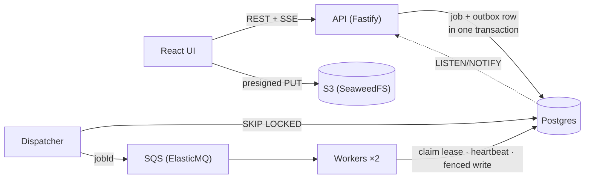

# Video Processing Pipeline

Upload → process → watch: a TypeScript implementation of the system design in [PROJECT_OVERVIEW.md](PROJECT_OVERVIEW.md). It covers a transactional outbox, queue-driven workers with fenced leases and heartbeats, idempotent APIs, and a React UI that shows the pipeline working live. It's built milestone by milestone; see [docs/ROADMAP.md](docs/ROADMAP.md) for the full plan.


| Milestone | Status |
|---|---|
| M0 Scaffold (workspaces, Docker infra, migrations) | ✅ |
| M1 Create / upload / complete / status, idempotent create | ✅ |
| M2 Jobs, transactional outbox, dispatcher, placeholder worker, leases + fencing + heartbeat, SSE live events | ✅ |
| M3 React UI: login, library, upload with progress, live pipeline view + event timeline | ✅ |
| M4 Retries + backoff, DLQ, reconciler, chaos controls | ⏳ next |
| M5 Real media: ffprobe/ffmpeg HLS, thumbnails, verify-before-publish | |
| M6 Versioned manifests, playback API, CDN cache, hls.js player | |
| M7 Resumable multipart upload in the browser | |
| M8 Metrics panel + structured logging | |
| M9 Docker packaging, CI, docs, hosted demo | |

## The UI

| Upload: bytes go browser → S3 directly | Library: live status and playable resolutions |
|---|---|
|  |  |

**After `kill -9` on a worker mid-transcode:** the 720p job's lease expired, another worker reclaimed it as attempt 2, and the video still finished. The timeline flags the reclaim and explains it.


## How it works (so far)



1. `POST /videos` creates the video and returns a presigned upload URL. The bytes go straight to storage.
2. `POST …/complete` checks the object in storage, then commits the `probe` job and its outbox row in one transaction.
3. The dispatcher sends due outbox rows to the queue, at least once.
4. A worker claims the job row, getting a lease and an attempt number that acts as a fencing token. It renews the lease while it works and commits results only if it still owns the job.
5. The probe fans out 360/720/1080 transcode jobs. Each finished rendition becomes playable immediately.
6. Every state change emits an event: a row in `job_events` plus `pg_notify`. The API streams these to the UI over SSE, and the UI refetches what changed.

Workers still run **placeholder** handlers (sleep + progress); real ffmpeg arrives in M5.

## Layout

```
apps/web/          React + Vite UI: library, upload, live pipeline view
apps/api/          Fastify HTTP API: routes → service → SQL; SSE event hub
apps/dispatcher/   Outbox → queue relay
apps/worker/       Queue consumer: claim, heartbeat, handlers, fenced results
packages/core/     Shared config, Postgres, S3, SQS, job state machine, domain types
migrations/        Plain .sql files, applied in filename order
infra/             Local S3 (SeaweedFS) and SQS (ElasticMQ) config
scripts/           dev supervisor, setup, test setup, browser smoke test
docs/              Roadmap and screenshots (architecture and demo docs come in M9)
```

## Running locally

Requires Node 24+ and Docker.

```sh
npm install
npm run infra:up     # Postgres :5433, S3 :8333, SQS :9324
npm run setup        # apply migrations, create bucket (safe to re-run)
npm test             # integration tests (isolated DB, queue and bucket)
npm run dev          # UI :5173, API :3000, dispatcher, 2 workers (auto-restarting)
```

Open **http://localhost:5173**, pick any username, and upload a file. Until M5 the workers are placeholders and don't read the bytes, so any file works.

- `npm run dev -- --workers 3` runs more workers. `npm run dev:web`, `dev:api`, `dev:worker` and `dev:dispatcher` each run one service with reload on change.
- `PLACEHOLDER_STEP_MS=800 npm run dev` slows the fake jobs down, so you have time to watch, or to kill a worker.
- `npm run smoke:ui` (with the stack running) drives the UI in headless Chromium and saves screenshots to `./screenshots`. Run `npx playwright install chromium` once first.

### Walk through the pipeline with curl

```sh
# In one terminal: watch live events for user "alice"
curl -N localhost:3000/events -H 'x-user-id: alice'

# In another
printf 'fake video bytes' > /tmp/clip.mp4
SIZE=$(stat -f%z /tmp/clip.mp4)   # Linux: stat -c%s

curl -s -X POST localhost:3000/videos \
  -H 'x-user-id: alice' -H 'content-type: application/json' \
  -H 'idempotency-key: demo-1' \
  -d "{\"title\":\"Demo\",\"fileName\":\"clip.mp4\",\"fileSizeBytes\":$SIZE}"

curl -X PUT --data-binary @/tmp/clip.mp4 "<uploadUrl>"
curl -s -X POST localhost:3000/videos/<videoId>/uploads/<uploadId>/complete -H 'x-user-id: alice'

curl -s localhost:3000/videos/<videoId> -H 'x-user-id: alice'   # jobs + event timeline
```

`X-User-Id` is an auth stub for curl and tests. Browsers use the demo login cookie from `POST /session`. Either way, the server derives ownership; the request body never carries it.

## Things worth breaking on purpose

| Try this | What you'll see | Why |
|---|---|---|
| Re-send create with the same `idempotency-key` | Same `videoId`, header `idempotent-replayed: true` | Idempotency key table, scoped per user |
| Same key, different body | `422 idempotency_key_reused` | Request hash stored with the key |
| Call `/complete` twice | One probe job, same response | Conditional updates + `UNIQUE(video_id, kind, target_height)` |
| `/complete` before uploading | `409 upload_incomplete` | Storage is checked, not trusted |
| Upload fewer bytes than declared | Storage rejects the PUT | `Content-Length` is part of the signature |
| Run `PLACEHOLDER_STEP_MS=800 JOB_LEASE_SECONDS=8 npm run dev`, then `kill -9` the PID shown on a running job's lane in the UI | That job is reclaimed as attempt 2 after ~8 s, flagged in the timeline, and the video still ends `ready` | Unacked message reappears after the visibility timeout; the claim succeeds on the expired lease |
| Ctrl-C `npm run dev` while jobs are running, then start it again | The jobs are picked up immediately, not after a lease | Graceful shutdown releases the lease (fenced) and makes the message visible again |

## Notes and gotchas

- **S3 server:** MinIO no longer publishes community Docker images, so local S3 is SeaweedFS. The code is plain AWS SDK v3 and works unchanged against real S3.
- **Presigned URLs + AWS SDK checksums:** the S3 client sets `requestChecksumCalculation: "WHEN_REQUIRED"`. Without it, the SDK signs a CRC32 of an empty body into presigned PUT URLs, and every real upload fails with `BadDigest`.
- **Heartbeats aren't optional:** the first chaos run used jobs as long as the lease and no heartbeat, and it livelocked. Each attempt was reclaimed mid-run and then rejected by fencing (attempt 8 and counting). `apps/worker/test/heartbeat.test.ts` reproduces this with two competing workers.
- **Foreign keys take locks:** inserting a `job_events` row takes `FOR KEY SHARE` on its video. Recomputing the status with `FOR UPDATE`, which conflicts with that, deadlocked when two jobs finished at once. The UI smoke test caught it. The fix is `FOR NO KEY UPDATE`, and a regression test in `apps/worker/test/pipeline.test.ts` covers it.
- **Never abort a long-poll:** aborting `ReceiveMessage` mid-wait only closes the client's end. The queue can still hand the next message to that dead request and hide it for a full visibility timeout, which caused a 30 s stall after every restart. Workers now use 5 s polls and let them finish on shutdown.
- **Bucket CORS:** the browser PUTs straight to S3 from the UI's origin, so `npm run setup` applies a CORS rule (`CORS_ORIGINS`) to the bucket. The API itself needs no CORS, because the Vite dev server proxies `/api`.
- **Postgres `bigint`** comes back from `pg` as a string, since JS numbers can't hold every 64-bit integer. It's converted explicitly where it's used.
