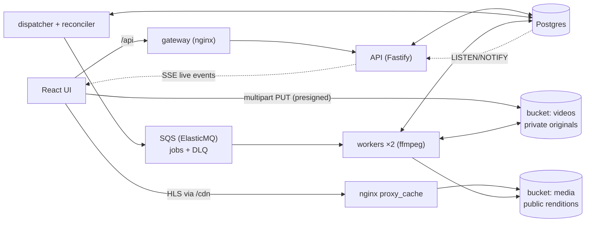

# Roadmap

This is how the design in [PROJECT_OVERVIEW.md](../PROJECT_OVERVIEW.md) becomes a finished, demoable system: a complete pipeline plus a small React UI that makes the system-design mechanics visible. Each milestone ends with green tests, an updated README table, and something new to see.

## The demo this builds toward

A ~60-second walkthrough:

1. Upload a video with a chunked progress bar.
2. Watch the probe job and the 360/720/1080 jobs move through the pipeline live.
3. 360p becomes playable while 1080p is still running.
4. Kill a worker mid-job. Its lease expires, another worker reclaims the job, and a late write from the dead attempt is rejected by fencing.
5. The video ends `ready` with adaptive playback.

## Target architecture

Key choices:

- **Live updates:** state changes write a `job_events` row and run `pg_notify` in the same transaction. The API holds one `LISTEN` connection and fans events out to browsers over Server-Sent Events. Events are hints to refetch, never state, the same principle as queue messages.
- **Two buckets:** originals stay private and are reachable only through presigned URLs. Renditions, thumbnails and manifests are public-read and served through the CDN.
- **Presign host:** `S3_PUBLIC_ENDPOINT` is the browser-reachable S3 URL, used only when signing. Signatures cover the host, so it can't be a path prefix behind nginx.
- **Demo login:** `POST /session` sets a signed cookie, because `EventSource` can't send custom headers. `X-User-Id` still works for tests and curl.
- **Chaos as data:** a `chaos_settings` row controls injected failures. "Kill worker" makes the worker hard-exit mid-job, and the supervisor restarts it.

## Milestones

| # | Milestone | Status |
|---|---|---|
| M0 | Scaffold: workspaces, Docker infra, migrations | ✅ |
| M1 | Create / upload / complete / status, idempotent create | ✅ |
| M2 | Jobs + transactional outbox + dispatcher + placeholder worker, leases/fencing/heartbeat, live events (SSE), dev supervisor | ✅ |
| M3 | React UI v1: login, library, upload, live pipeline view | ✅ |
| M4 | Retries with backoff + jitter, error classification, DLQ, reconciler, chaos controls | |
| M5 | Real media: ffprobe validation, thumbnails, ffmpeg HLS, progress, verify-before-publish | |
| M6 | Playback: versioned manifests, CDN cache, playback API, hls.js player | |
| M7 | Resumable multipart upload in the browser | |
| M8 | Metrics panel + structured logging | |
| M9 | Docker packaging, CI, Playwright smoke, docs, hosted deploy | |

### M2: Jobs, outbox, dispatcher, placeholder worker ✅
- `/complete` creates the `probe` job, its outbox row and a timeline event in the same transaction as the status change.
- The dispatcher sends due outbox rows using `FOR UPDATE SKIP LOCKED`. Delivery is at-least-once.
- The worker receives a message, claims the job with a fenced lease, runs a placeholder handler and writes a fenced result. The probe fans out the transcode jobs.
- A heartbeat renews the DB lease and the SQS visibility every lease/3, and abandons the work if the lease is lost. It was pulled forward from M4 after a chaos run livelocked without it.
- API: `GET /videos`, `GET /videos/:id`, `GET /events` (SSE), `POST|GET|DELETE /session`.
- `npm run dev` runs a supervisor for the API, the dispatcher and 2 workers, with auto-restart.

### M3: React UI v1 (`apps/web`) ✅
- Vite + React + TS. Plain CSS modules and no component library.
- **Login:** pick a demo username.
- **Library:** grid with thumbnail, title, status badge and resolution chips, updated live.
- **Upload:** drag and drop, single PUT with a progress bar.
- **Video detail:** one lane per job showing state, attempt `n/max`, progress, worker and last error, with an event timeline below.
- A typed API client and a `useLiveQuery` hook: fetch, then refetch on matching SSE events, coalesced and protected against out-of-order responses. Response types come from `@vpp/core/domain`, a browser-safe entry point, so the UI and API share one definition.
- Bucket CORS was pulled forward from M7, since the browser PUTs straight to S3. `GET /session` became public and returns `null` when logged out, so first load logs no 401s.
- `npm run smoke:ui` drives the real UI in headless Chromium. Its first runs found three backend bugs, all fixed with regression tests:
  - **Deadlock:** the FK lock from inserting a `job_events` row conflicted with the `FOR UPDATE` in `recomputeVideoStatus`, so two jobs finishing at once deadlocked. Fixed with `FOR NO KEY UPDATE`.
  - **Zombie long-polls:** aborting `ReceiveMessage` during shutdown let the queue hand the next message to a dead request, hiding it for a whole visibility timeout. Workers now use 5 s polls and never abort one.
  - **Slow handoff on shutdown:** a worker stopped mid-job now releases its lease (fenced) and makes the message visible again, so another worker resumes the job immediately.

### M4: Reliability and chaos controls
- Errors are classified as `RetryableError` or `PermanentError`.
  - **Retryable:** the job goes back to `pending` with `next_attempt_at = now() + backoff`, using exponential backoff with full jitter, and a delayed outbox row is written.
  - **Exhausted or permanent:** the job becomes `failed`.
- The claim respects `max_attempts`.
- A reconciler in the dispatcher re-outboxes jobs whose lease expired and pending jobs that have no outbox row. It also fails jobs that have used all their attempts.
- Workers register in a `workers` table with heartbeats.
- **Chaos panel:**
  - A worker list with a Kill button.
  - A failure-rate slider.
  - Toggles for crash-after-output-write, permanent failure, slow mode and pausing the dispatcher.

### M5: Real media processing
- The worker image is `node:24-bookworm-slim` plus ffmpeg.
- **Probe:** ffprobe validation, with a duration over 30 min treated as a permanent failure. It extracts a thumbnail and fans out jobs only for heights at or below the source height.
- **Transcode:** HLS with a fixed GOP so segments align across renditions. Progress comes from `-progress pipe:1`. Output goes to `media/renditions/{videoId}/{height}/a{attempt}/`.
- Output is verified before publishing, using an ffprobe pass over the produced playlist.

### M6: Playback and CDN
- Each rendition completion writes an immutable `master.v{n}.m3u8`, then swaps `videos.manifest_version` under the video row lock.
- nginx `proxy_cache` sits in front of the `media` bucket and exposes `X-Cache-Status`.
- `GET /videos/:id/playback` returns the playback URL, or 409 with the status when nothing is playable yet.
- The hls.js player has a quality menu, a bandwidth readout and a CDN HIT/MISS badge. It upgrades when a new manifest version arrives.

### M7: Resumable multipart upload
- Every upload is a multipart upload with 8 MiB parts.
- `POST /videos/:id/uploads/:uploadId/parts` lists the parts already in storage, since storage is authoritative, and presigns URLs only for the missing ones.
- The browser uploads 4 parts concurrently and retries each part independently. It shows a per-part grid and resumes after a refresh, using `localStorage` and re-selecting the same file.
- Bucket CORS is set through `PutBucketCors`, which needs a spike first. Abandoned uploads expire through a lifecycle rule.

### M8: Metrics and observability
- `GET /admin/metrics` reports:
  - Queue and DLQ depth.
  - Jobs by state.
  - Oldest pending age.
  - Throughput.
  - p50/p95 job duration.
  - Live workers.
- The same data is exposed in Prometheus text format at `/metrics`.
- The UI shows stat tiles with sparklines.
- Logging uses pino with child loggers bound to `videoId` / `jobId` / `attempt`.

### M9: Packaging, CI, docs and deploy
- One multi-stage Dockerfile. The compose `app` profile adds the API, the dispatcher, 2 workers and an nginx gateway. `npm run demo` starts everything at `http://localhost:8080`.
- `scripts/seed.ts` generates a 1080p test clip with ffmpeg `testsrc2`, so no binaries are committed.
- GitHub Actions runs the typecheck, the tests with real containers, and a Playwright smoke test.
- Hosted mode (`DEMO_PUBLIC=true`) adds:
  - Caddy for TLS.
  - Upload caps.
  - Rate limits.
  - Chaos auto-reset.
  - 24 h cleanup of uploaded videos.
- New docs: `docs/ARCHITECTURE.md` (sequence diagrams and a failure-mode table), `docs/DEMO.md` (an interview walkthrough) and `docs/DEPLOY.md`. The README is rewritten as a portfolio landing page.
